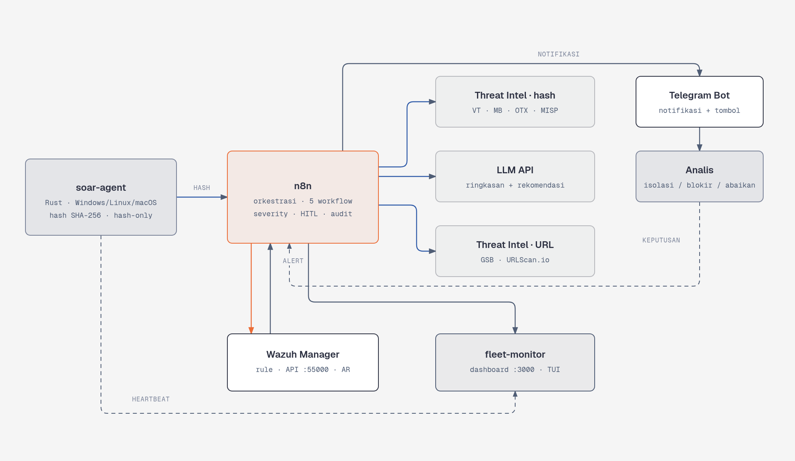

<div align="center">

# Agentic-Driven Open-Source SOAR

**Autonomous AI-Driven Security Orchestration, Automation, and Response Platform Built on Wazuh, n8n, Rust Endpoint Agents, and Human-in-the-Loop Governance**

[](#)
[](https://github.com/ravi-arnan/soar-project/releases/tag/v1.1.0)
[](https://github.com/ravi-arnan/soar-project/actions/workflows/ci.yml)
[](#core-focus-agentic-driven-soar)
[](https://wazuh.com)
[](https://n8n.io)
[](agent-rs/)
[](scripts/soar_mcp_server.py)
[](https://www.docker.com)
[](https://www.python.org)

Autonomous threat reasoning, multi-source threat intelligence consensus, external AI agent integration over MCP, and tiered containment (Autonomous + Human-in-the-Loop).

</div>

---

## Core Focus: Agentic-Driven SOAR

Instead of relying purely on static `if-then` playbooks, this project places **AI agents at the center of alert triage, context synthesis, and response orchestration**, constrained by strict operational guardrails:

1. **AI Reasoning & Dynamic Multi-Provider Engine**:
   Every incident passing pre-scan filters is analyzed by an AI agent to produce structured reasoning, **MITRE ATT&CK** technique mapping, and containment recommendations. Primary and fallback providers (`Google Gemini`, `OpenAI GPT`, `Anthropic Claude`, `Pollinations`, `Experiential Labs`, and OpenAI-compatible custom endpoints such as `Ollama`, `Groq`, or `vLLM`), along with **Saved API Keys** and live model discovery, are configurable at runtime through the Dashboard Settings UI without restarting services.
2. **External AI Agent Access via MCP & Scoped API Keys**:
   Includes a pure Python stdlib **SOAR MCP Server** ([`scripts/soar_mcp_server.py`](scripts/soar_mcp_server.py)) implementing JSON-RPC 2.0 over stdio, paired with granular scoped API keys (`read:fleet`, `read:intel`, `write:actions`) and a copy-ready **Agent Setup Prompt** in the dashboard. External AI agents such as Antigravity (`agy`), Claude Code, Codex, Cursor, and OpenCode can inspect fleet health, query IoC reputations, and trigger Active Response actions programmatically.
3. **Confidence-Based Escalation & Anti-Overreaction**:
   - **CRITICAL / High Confidence**: Autonomous execution of containment (`quarantine` or `sinkhole`) with real-time Telegram reporting.
   - **HIGH / Ambiguous**: The agent prepares full reasoning and mitigation context, then delegates final execution to a human analyst via **Human-in-the-Loop (HITL)** approval controls in Telegram and the Dashboard.
   - **INFO / Benign**: Routine OS and baseline artifacts are classified cleanly without quarantine actions or noisy external OSINT lookups, keeping analysts focused on real threats.
4. **Lightweight Cross-Platform Endpoint Telemetry (`soar-agent` + Wazuh)**:
   Endpoints run a lightweight Rust agent ([`agent-rs/`](agent-rs/)) supporting Linux, Windows, and macOS. Only metadata and SHA-256 hashes leave the endpoint; raw file contents are never uploaded.

---

## Architecture



Four core architectural layers:

| Layer | Components & Responsibilities |
|-------|-------------------------------|
| **Endpoint Fleet** | `soar-agent` (Rust: FIM for `~/Downloads`, `~/Desktop`, USB; SHA-256 hashing; local quarantine/restore; on-demand scan) and `Wazuh Agent` (process-chain correlation and SIEM rules). |
| **Agentic Orchestration & AI** | `n8n` (playbook orchestration, deduplication, selective media triage), Multi-Provider AI Engine (dynamic Primary + Fallback LLM routing), and `soar_mcp_server.py` (MCP interface for external AI agents). |
| **Control Plane & Threat Intel** | `fleet-monitor` (Python stdlib: SQLite durable event store, differential TTL verdict cache, Active Response command queue, RBAC, M2M API keys), `misp-index` (CIRCL OSINT feed), VirusTotal, MalwareBazaar, AlienVault OTX, Google Safe Browsing, and URLScan.io. |
| **Dashboard & HITL Interface** | Next.js Web UI styled after Wazuh Dashboard (`WUI`), public zero-config agent installer portal (`/install`), `fleet-tui.py` (SSH curses TUI), and bidirectional Telegram Bot (`tg-callback-poller.py` + `alert-log.py`). |

Detailed architecture and flow references: [`docs/arsitektur/ARCHITECTURE.md`](docs/arsitektur/ARCHITECTURE.md), [`docs/arsitektur/FLOW.md`](docs/arsitektur/FLOW.md), [`docs/panduan/PANDUAN-DIAGRAM.md`](docs/panduan/PANDUAN-DIAGRAM.md).

---

## End-to-End Workflow

1. **Endpoint Detection**: A new or modified file is detected on an endpoint; `soar-agent` computes its SHA-256 hash and sends a lightweight payload (1-2 KB) to the n8n webhook.
2. **Noise Filtering & Deduplication**: Temporary browser artifacts (`*.part`, `*.crdownload`), 0-byte files, post-quarantine delete events, and 5-minute duplicates are dropped before consuming external API quota.
3. **Threat Intel Synthesis**: Hashes are checked against the SQLite verdict cache (differential TTL: 7 days malicious, 24 hours clean, 6 hours unknown), then evaluated via multi-source consensus across VirusTotal, MalwareBazaar, MISP OSINT, and AlienVault OTX (or Google Safe Browsing + URLScan.io for phishing URLs).
4. **AI Agent Triage**: The active LLM generates contextual reasoning, MITRE ATT&CK mapping, and response recommendations, automatically failing over to the fallback provider if needed.
5. **Tiered Execution**: Autonomous containment for `CRITICAL` threats, analyst HITL approval via Telegram/Dashboard for `HIGH` threats, and silent baseline logging for `INFO`/`BENIGN` artifacts.
6. **Observability & Forensics**: All telemetry persists in SQLite and merges seamlessly with historical archives in Wazuh Indexer (`wazuh-alerts-*`).

---

## Dashboard Module Separation

To avoid operational overlap across the SOC workflow, the three primary investigation views serve distinct purposes:

| Module | Perspective | Operational Goal |
|--------|-------------|------------------|
| **Security events** | Alert timeline & fleet aggregation | Track daily alert trends, top 5 active agents, server-side search and filtering (`q`, `severity`, `agent_id`, `24h`-`90d` or custom time ranges), pagination (`10`, `25`, `50`, `100`, `All`), CSV export, and quick Active Response on non-`INFO` alerts. |
| **Threat Intel** | IoC reputation & AI reasoning | Inspect AI verdict (`MALICIOUS`, `SUSPICIOUS`, `BENIGN`), active model reasoning, **MITRE ATT&CK** mapping, mitigation guidance, and OSINT pivots/quarantine controls for non-`INFO` artifacts. |
| **Integrity monitoring (FIM)** | Per-file inventory & host forensics | Audit monitored files by path with full metadata (`User`, `Group`, `Size`, `Inode`, `MD5`, `SHA1`, `SHA256`, `Permissions`), per-file change history, and Syscheck baseline assessment. |

Additional modules: **Overview Hub**, **Agents Management & Detail** (with per-agent **Command Execution ACK History** and **Poll Token Rotation / Revocation**), **Deploy agent** (and public `/install` portal with SHA-256 verification and one-time `claim_secret` pickup), **MITRE ATT&CK Matrix** (live 30-day rule telemetry), **Network map**, **Users (RBAC)**, **API Keys (Step-Up 2FA + AI Agent Setup Prompt)**, **Settings (AI Engine, Threat Intel Policy, Persistent Command Queue, and SHA-256 Hash-Chained Audit Trail)**, **Alert Triage Lifecycle** (`new`, `investigating`, `contained`, `false_positive`, `resolved`), **Web Dashboard HITL Approval Queue**, and **URL Deep-Linking**.

---

## Technology Stack

| Component | Role | Baseline |
|-----------|------|----------|
| **Wazuh Manager & Indexer** | SIEM, process-chain rule correlation, OpenSearch storage, Active Response | 4.14.8 |
| **n8n** | Webhook playbook orchestration and workflow automation | 2.42.5 |
| **soar-agent** | Lightweight endpoint agent: FIM, SHA-256, quarantine, restore, scan | Rust (`agent-rs/`) |
| **fleet-monitor** | Control plane API, SQLite history, VT/OSINT cache, RBAC & M2M keys | Python 3.12 stdlib |
| **dashboard** | Wazuh-style Web UI, `/install` portal, auth & RBAC API proxy | Next.js 16 (App Router) |
| **soar_mcp_server.py** | JSON-RPC 2.0 stdio MCP server for external AI agents | Python 3 stdlib |
| **misp-index & alert-log** | CIRCL OSINT MISP feed sync and outbound Telegram alert observability | Python 3.12 stdlib |
| **Cloudflare Zero Trust** | Tunnel ingress + Cloudflare Access SSO and session logout (`/cdn-cgi/access/logout`) | Cloudflare Access |

---

## Setup & Quick Start

### 1. Server Bootstrap
```bash
# Copy .env.example to .env and populate required tokens and API keys
cp .env.example .env

# Run idempotent server bootstrap (Wazuh certs, Docker Compose, n8n workflow sync)
bash deploy/setup-server.sh
```

> Required `.env` secrets for full operation: `FLEET_COMMAND_TOKEN`, `FLEET_AGENT_POLL_TOKENS_JSON`, and `DASHBOARD_LOGIN_TOKEN` (minimum 32 random characters, no placeholder prefixes).

### 2. Zero-Config Endpoint Enrollment
Open the public installer portal at **`https://soar-agent.raviarnan.dev`** (or **Deploy agent** inside the dashboard) and choose your target platform:
- **Linux**: single-line installer `curl -sSL https://soar-agent.raviarnan.dev/api/enroll/script?os=linux | sudo bash`, `.deb` package, or NixOS module ([`deploy/nixos/`](deploy/nixos/)).
- **Windows**: PowerShell enrollment script (`deploy/install-agent-windows.ps1`) or portal one-liner.
- **macOS**: Darwin installer script from `/install`.
- **Wazuh Agent / Other OS**: standard Wazuh Agent commands for FreeBSD/Solaris/AIX/Source and fleet-wide Ansible rollout ([`deploy/ansible/`](deploy/ansible/)).

Newly enrolled hosts enter **Pending Approvals** and activate immediately once approved by an Admin in the dashboard.

### 3. External AI Agent Integration (MCP & API Keys)
1. Navigate to **Settings -> API Keys & Agent Access** in the dashboard (gated by dual-channel Email + Telegram 2FA).
2. Generate an API key with least-privilege scopes (`read:fleet`, `read:intel`, `write:actions`).
3. Copy the built-in **AI Agent Setup Prompt** and cURL snippets from the guide, or register `scripts/soar_mcp_server.py` as an MCP server in your AI client.

---

## Security & Governance

- **Cryptographic Zero-Trust & RBAC**: Verifies **Cloudflare Access** JWTs (`cf-access-jwt-assertion`) cryptographically via RS256 JWKS (`CF_ACCESS_TEAM_DOMAIN` + `CF_ACCESS_AUD`) and rejects unverified raw identity headers. Supports signed HMAC session cookies (`soar_session`), PBKDF2-HMAC-SHA256 (600,000 iterations), CSRF Origin validation, and strict HTTP security headers (CSP, `X-Frame-Options`, `X-Content-Type-Options`, `Referrer-Policy`, `Permissions-Policy`) across `admin`, `analyst`, and `viewer` roles.
- **Persistent Command Queue & Execution ACK**: Active Response commands (`quarantine`, `restore`, `sinkhole`, `unsinkhole`, `scan`) persist in SQLite (`commands` table) across restarts and track end-to-end execution status (`queued -> delivered -> succeeded / failed / expired`) via authenticated agent ACKs (`POST /api/commands/ack`).
- **Tamper-Evident SHA-256 Audit Trail**: Every sensitive control-plane action (logins, RBAC user changes, API key creation/revocation, agent enrollment/rotation/revocation, command dispatch/ACK, triage updates, HITL resolution, and AI/TI settings changes) is recorded in a SHA-256 hash-chained `audit_logs` table with live chain verification (`GET /api/audit?verify=1`).
- **Active Response Safety & Cross-Platform Parity**: Symlink rejection, canonicalized OS path denylists, protected infrastructure domain denylists, manifest-bound file restoration, Windows cross-drive (`ERROR_NOT_SAME_DEVICE=17`) and `icacls` ACL hardening, and ransomware decoy canary monitoring (`EventKind::Modify` & `EventKind::Remove`, rule `100004`).
- **Credential Hygiene & At-Rest Encryption**: Runtime secrets remain strictly in `.env` (gitignored), stored AI/TI provider keys are encrypted at rest (`SOAR_SETTINGS_ENCRYPTION_KEY`), and endpoint file contents never leave the host.

---

## Benchmarks & Empirical Evaluation

All metrics below are measured directly against live deployments (`scripts/benchmark-soar.py` and `scripts/benchmark-llm-consistency.py`), with raw JSON datasets stored in [`docs/evaluasi/`](docs/evaluasi/).

| Metric | Measured Result | Sample / Scope | Source |
|--------|-----------------|----------------|--------|
| **Malware Auto-Containment MTTR** | **1.68s** mean (median `1.42s`, range `1.21-2.42s`) | `N=15`, warm VT cache, Wazuh FIM -> quarantine | [`EVALUASI-METRIK.md`](docs/evaluasi/EVALUASI-METRIK.md) |
| **Rust `soar-agent` Malware MTTR** | **0.04s** mean (median `0.03s`, P95 `0.05s`) | `N=30`, warm VT cache, local HTTP quarantine | [`bench-rust-mttr-malware.json`](docs/evaluasi/bench-rust-mttr-malware.json) |
| **Phishing Domain Sinkhole MTTR** | **2.13s** mean (range `1.83-2.44s`) | `N=5`, Google Safe Browsing fast path | [`EVALUASI-METRIK.md`](docs/evaluasi/EVALUASI-METRIK.md) |
| **End-to-End Verdict Pipeline Latency** | **3.00s** mean (P95 `4.09s`, `0/30` timeouts) | `N=30`, live VT + OTX lookup -> `fleet-log` | [`bench-mttr-fleet-20260915-N30.json`](docs/evaluasi/bench-mttr-fleet-20260915-N30.json) |
| **HITL Automated Dispatch Overhead** | **21.05s** Telegram prep + **0.07s** Wazuh AR dispatch | `N=5` (automated portion; ~18s is cloud LLM call) | [`bench-mttr-hitl-20261008.json`](docs/evaluasi/bench-mttr-hitl-20261008.json) |
| **False-Positive Suppression Rate** | **100%** (`8/8` benign files suppressed to `0` alerts/AR) | `N=8` mixed extensions vs `8` raw Wazuh FIM alerts | [`EVALUASI-METRIK.md`](docs/evaluasi/EVALUASI-METRIK.md) |
| **Sustained Webhook Throughput** | **34.11 alerts/s** (`142.12 ms` avg) / **29.49 alerts/s** (`soar-agent`) | `N=20`, concurrency `5` | [`bench-load.json`](docs/evaluasi/bench-load.json), [`bench-rust-load.json`](docs/evaluasi/bench-rust-load.json) |
| **VT Verdict Cache Hit Rate** | **41.7%** (`10/24` lookups, saves free-tier 4 req/min quota) | `N=12` cold/hot runs | [`bench-vt-cold-vs-cache-20261008.json`](docs/evaluasi/bench-vt-cold-vs-cache-20261008.json) |
| **LLM Guardrail & Prompt-Injection Resilience** | **100%** rule adherence (`34/35` API successes, Jaccard `0.450`) | `7` scenarios x `N=5` (incl. malicious filename injection) | [`bench-llm-consistency-20261022.json`](docs/evaluasi/bench-llm-consistency-20261022.json) |
| **Rust Endpoint Agent Footprint** | **~5.4 MB** Linux / **~12 MB** Windows binary, **~7-10 MB** RSS | >90% RAM reduction vs traditional Wazuh agent (~80-150 MB) | [`PERBANDINGAN-PENELITIAN.md`](docs/ilmiah/PERBANDINGAN-PENELITIAN.md) |

---

## Platform & Research Comparison

Detailed empirical comparisons are documented in [`docs/ilmiah/N8N-VS-SHUFFLE.md`](docs/ilmiah/N8N-VS-SHUFFLE.md) and [`docs/ilmiah/PERBANDINGAN-PENELITIAN.md`](docs/ilmiah/PERBANDINGAN-PENELITIAN.md).

### n8n vs Shuffle SOAR (Empirical Architecture Selection)

| Dimension | Weight | n8n (This Project) | Shuffle SOAR |
|-----------|--------|--------------------|--------------|
| **Code Execution Flexibility** | High | **4/5** (JS/TS Code nodes, HTTP + parse + cache in one node) | 2/5 (requires custom Python Shuffle Apps per logic block) |
| **State & Cache Persistence** | High | **5/5** (built-in `staticData` + paired `fleet-monitor` SQLite cache) | 1/5 (no built-in workflow state persistence) |
| **Built-In Security Integrations** | Medium | 2/5 (custom HTTP integrations for Wazuh/VT/GSB/MISP) | **4/5** (built-in security apps out of the box) |
| **Observability & Debugging** | Medium | **4/5** (execution history, pin data, `/metrics`) | 3/5 (execution history, no native Prometheus endpoint) |
| **Deployment & Memory Overhead** | Medium | **4/5** (~370 MB RAM, single container + SQLite) | 2/5 (~800 MB RAM, Elasticsearch/PostgreSQL + multi-container) |
| **Human-in-the-Loop (HITL)** | Medium | **4/5** (Telegram inline callbacks + Web Dashboard queue + SLA) | 3/5 (app-based callback handling) |
| **Weighted Overall Score** | | **3.8 / 5** | **2.5 / 5** |

### Positioning vs Existing Open-Source & Commercial SOAR

- **vs Rule-Only Wazuh / 1-Way Alerting**: Raw FIM rules alert on every new file; VT/MalwareBazaar/MISP gating suppresses 100% of benign noise while isolating high-confidence threats autonomously.
- **vs Commercial SOAR (Cortex XSOAR, Splunk SOAR)**: Commercial platforms target large enterprise SOCs with broad SaaS/IAM/cloud connectors at high licensing cost. This project targets SMEs and research labs with zero software license cost, transparent self-hosted workflows, reversible containment (`quarantine` + `restore`, `sinkhole` + `unsinkhole`), and native MCP agent access.
- **MITRE ATT&CK Coverage**: Covers endpoint malware execution (`T1204.002`, `T1059`, `T1027`, `T1036`), phishing initial access (`T1566.002`, `T1189`), LOLBin & pre-encryption ransomware chains (`T1059.001`, `T1059.006`, `T1105`, `T1140`, `T1197`, `T1218.005/.010/.011`, `T1490`), persistence (`T1547.001`, `T1053.005`), and active remediation (`T1484`, `T1070.004`, `T1499`). See [`docs/ilmiah/MITRE-ATTACK-MAPPING.md`](docs/ilmiah/MITRE-ATTACK-MAPPING.md).

---

## Documentation Index

English guides live in [`docs/en/`](docs/en/), while extended academic evaluation and thesis engineering notes in [`docs/`](docs/) are maintained in Indonesian:

| Document | Language | Purpose |
|----------|----------|---------|
| [`docs/en/ARCHITECTURE.md`](docs/en/ARCHITECTURE.md) | English | v1.1.0+ architecture, control plane, MCP, and tiered autonomy model |
| [`docs/en/DEPLOYMENT.md`](docs/en/DEPLOYMENT.md) | English | Server bootstrap, `.env` configuration, endpoint enrollment, and verification |
| [`docs/evaluasi/EVALUASI-METRIK.md`](docs/evaluasi/EVALUASI-METRIK.md) | Indonesian | Quantitative evaluation methodology, MTTR, FP/FN, throughput, and LLM tests |
| [`docs/ilmiah/N8N-VS-SHUFFLE.md`](docs/ilmiah/N8N-VS-SHUFFLE.md) | Indonesian | Empirical scoring and trade-off analysis between n8n and Shuffle |
| [`docs/ilmiah/PERBANDINGAN-PENELITIAN.md`](docs/ilmiah/PERBANDINGAN-PENELITIAN.md) | Indonesian | Literature and open-source SOAR feature matrix (15 reference systems) |
| [`docs/ilmiah/MITRE-ATTACK-MAPPING.md`](docs/ilmiah/MITRE-ATTACK-MAPPING.md) | Indonesian | Playbook and Wazuh/Sysmon rule mapping to MITRE ATT&CK v15.1 |
| [`docs/panduan/PANDUAN-AI-AGENT-MCP.md`](docs/panduan/PANDUAN-AI-AGENT-MCP.md) | Indonesian | Connecting external AI agents via `scripts/soar_mcp_server.py` |

---

## Repository Structure

```text
soar-project/
├── docker-compose.yml              # n8n, fleet-monitor, dashboard, health-monitor, poller, misp-index
├── wazuh-docker/single-node/       # Wazuh manager + indexer + dashboard
├── agent-rs/                       # soar-agent (Rust): FIM, SHA-256, quarantine, restore, scan
├── dashboard/                      # Next.js Web UI (Wazuh/OUI primitives, /install, API proxies)
├── deploy/                         # setup-server.sh, n8n-setup.py, OS installers, Ansible, NixOS
├── scripts/
│   ├── fleet-monitor.py            # Control plane API, SQLite store, VT/OSINT cache, RBAC, API keys
│   ├── soar_mcp_server.py          # JSON-RPC 2.0 stdio MCP server for external AI agents
│   ├── fleet-tui.py                # Terminal dashboard (curses)
│   ├── health-monitor.py           # Pipeline & container health monitor
│   ├── custom-n8n.py               # Wazuh integratord bridge to n8n webhooks
│   ├── tg-callback-poller.py       # Telegram HITL callback long-poller to n8n
│   └── patch-n8n-*.py              # Idempotent live n8n workflow patchers with local backups
├── config/wazuh/                   # Persistent Wazuh Manager & Agent configurations
└── docs/                           # Architecture, flows, guides, and diagrams
```

---

## Local Verification & Tests

```bash
# Dashboard unit tests (28/28), ESLint, TypeScript check, and Next.js production build
npm --prefix dashboard run check

# Full Python Backend, SOC Ops, MCP, AR & Setup test suites (211/211)
python3 -m unittest discover -s scripts -p 'test_*.py'
python3 -m unittest discover -s deploy -p 'test_*.py'

# Rust soar-agent unit tests (19/19)
cargo test --manifest-path agent-rs/Cargo.toml
```

---

## License

Open-source academic project. Individual components follow their respective upstream licenses:
**Wazuh** (GPLv2), **n8n** (Sustainable Use License), **soar-agent Rust** (GPL-2.0).

<div align="center">

Developed as an Undergraduate Thesis Project by **Ravi Arnan Irianto**, Information Technology, Udayana University.

</div>
